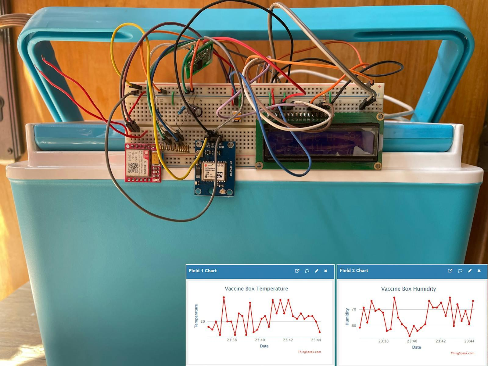
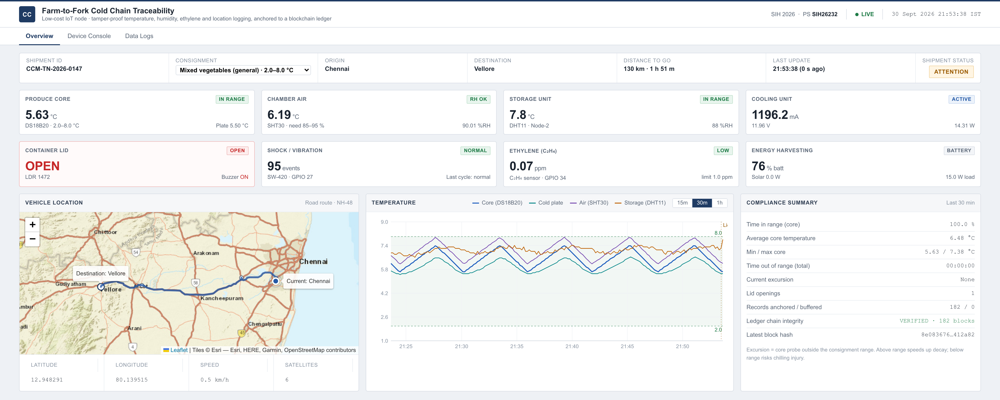

# SmartCool - Farm-to-Fork Cold Chain Traceability Node

Smart India Hackathon 2026 | Problem Statement **SIH26232** - Low-Cost IoT Blockchain Nodes for Farm-to-Fork Traceability
Theme: Agriculture, FoodTech & Rural Development | Category: Hardware
Team **INVICTUS** (Team ID 159400)

**Solution video:** https://youtu.be/o2jbTQCLLzo
**Presentation:** [presentation/SIH26232_INVICTUS_Presentation.pdf](presentation/SIH26232_INVICTUS_Presentation.pdf)



## The problem

A large share of fruits and vegetables is lost between harvest and market because farmers
don't have cold storage close to the farm, and there is no trustworthy record of how the
produce was stored on the way. Temperature logs, where they exist at all, are kept on
paper or in systems anyone can edit.

## What we built

A small solar-powered cold storage unit for farm gates, village collection centres and
FPOs, with an ESP32-based monitoring node inside it.

- Insulated chamber with DC compressor cooling, running on Solar PV -> MPPT -> battery,
  so it keeps working where the grid is unreliable
- ESP32 closed-loop control that holds crop-specific temperature and humidity
- Energy-aware modes (Normal / Energy-Aware / Critical) when the battery runs low
- Fault alerts for high temperature, door open, low battery, solar charging and cooling
  failure, using a local buzzer, LED and display, so no internet is needed
- Offline-first logging to microSD with an RTC timestamp, synced later over Wi-Fi / GSM
- Every sensor record is SHA-256 hashed and chained, and the chain is anchored to a
  ledger, so nobody can quietly change a reading later. That gives a tamper-proof
  record from farm to fork.

## Dashboard



`dashboard/index.html` is the monitoring dashboard for the traceability node. Open it in
any browser; nothing needs to be installed. It shows:

- live tiles for produce core temperature, chamber air, storage unit, cooling current,
  lid status, vibration, ethylene and solar/battery
- a temperature chart with the safe band for the selected crop
- vehicle location on the map (Chennai -> Vellore route)
- a compliance summary with time in range, lid openings and ledger chain integrity
- a device console and a data log view (`Device Console` and `Data Logs` tabs)

The page runs on simulated readings, so it works without the hardware connected. The map
tiles need an internet connection; without one it falls back to a simple route sketch.

## Repository layout

```
dashboard/        traceability dashboard (single HTML file)
firmware/         ESP32 sketch + the web files served from LittleFS
  README_WIRING.md  pin map, libraries and upload steps
backend/          Flask + SQLite server, login, admin/user dashboards,
                  ML model that predicts safe holdover time
tools/            mock_device.py - fakes the ESP32 so the dashboard can be tested
wokwi/            Wokwi simulation of the ESP32 and sensors
sensor-tests/     small sketches we used to bring up each sensor one by one
                  (DHT11, DS18B20, INA219, NEO-6M GPS, SIM800L, SD card, ...)
hardware/         3D model of the enclosure (OpenSCAD + STL) and wiring diagrams
docs/             project flow, component list, research sources
presentation/     SIH idea presentation (.pptx and .pdf)
images/           prototype photo and dashboard screenshot
```

## Hardware used

| Part | Purpose |
|---|---|
| ESP32 Dev Module (WROOM-32) | main controller |
| DS18B20 (waterproof) | produce core / cold plate temperature |
| DHT22 / DHT11 / SHT30 | air temperature and humidity |
| DS3231 RTC | timestamps when offline |
| microSD module | offline log storage |
| SSD1306 OLED, buzzer, LED | local display and alerts |
| INA219 | cooling unit voltage / current |
| SW-420 | shock and vibration |
| Reed switch / LDR | lid / door open detection |
| NEO-6M | GPS location |
| SIM800L | GSM uplink where there is no Wi-Fi |
| Solar panel, MPPT controller, 12 V battery | off-grid power |

The full list with specs is in `docs/Component_List.docx`.

## How to run

**Dashboard only:** open `dashboard/index.html` in Chrome or Firefox.

**Firmware (ESP32):**
1. Install Arduino IDE 2.x and the ESP32 board package (Espressif).
2. Install the libraries listed in `firmware/README_WIRING.md`.
3. Set your Wi-Fi name and password at the top of `firmware/cold_chain_esp32/cold_chain_esp32.ino`.
4. Tools -> Partition Scheme -> "No OTA (2MB APP/2MB SPIFFS)".
5. Upload the `data/` folder to LittleFS once (Ctrl+Shift+P -> "Upload LittleFS to Pico/ESP8266/ESP32"),
   then upload the sketch.
6. The board also starts its own hotspot `ColdChain-BOX01`, so the on-board dashboard can
   be opened even without a router.

**Backend (optional):**
```
cd backend
pip install -r requirements.txt
python app.py
```
It runs on http://localhost:5000. To test without hardware, run `python3 tools/mock_device.py`
in another terminal.

**Simulation:** see `wokwi/README.md`.

## Status

- The prototype is built and has been tested for temperature stability, cooling response,
  solar charging, battery backup, alert response and offline log retention.
- Each sensor was first tested on its own (`sensor-tests/`) before being combined.
- The dashboard in this repo runs on demo data so it can be viewed anywhere.

## Team

Team INVICTUS - Smart India Hackathon 2026
